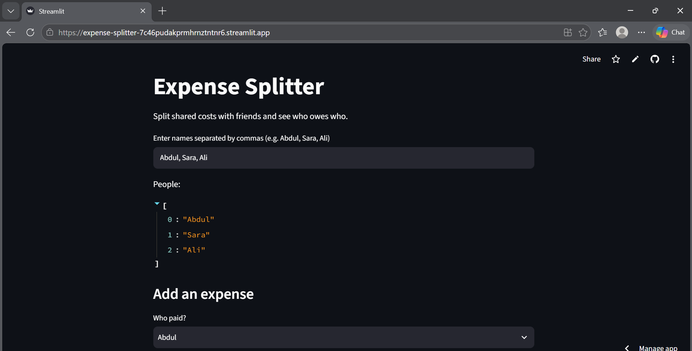

# Expense Splitter

A small Python app that splits shared costs between a group of people and works out who owes who.

I built this after getting tired of doing this math manually whenever a group of us split a bill, rent, or a trip. You add people, log who paid for what, and it tells you the fairest way to settle up.

Built with Python and Streamlit.

**To run it locally:**

1. Install requirements: `pip install streamlit`
2. Run the app: `streamlit run app.py`

**To run the tests:**

1. Install pytest: `pip install pytest`
2. Run: `python -m pytest`

The maths lives in `splitter.py`, and the tests in `test_splitter.py` check it with known answers, like a 30 bill split three ways.